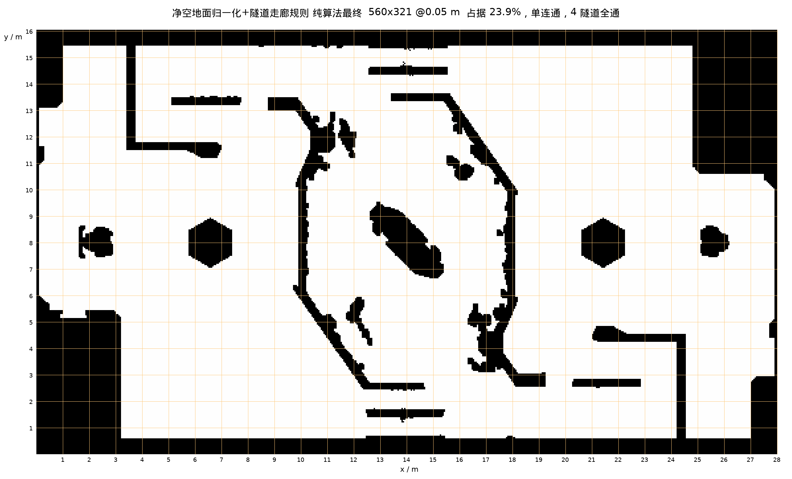
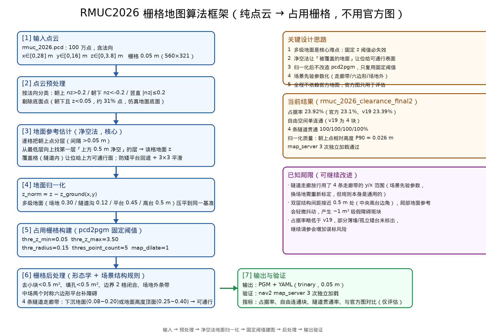

# pcd2pgm_clearance_final

> 从多级地面的仿真点云生成导航用 2D 栅格地图（0.05 m/格）。
> 核心思路：先做**逐格局部地面估计 + 高度归一化**，把场地里的多级地面压平到同一基准，
> 再复用固定阈值建图器（`pcd2pgm`），最后用通用后处理规则整理成干净、单连通、隧道全通的地图。
> **全程不依赖官方地图**（官方图只用于结果评估）。

## 效果

| 指标 | 本方法 | 参考（官方图） |
|---|---|---|
| 占据率 | **23.92%** | 23.1% |
| 自由空间连通块 | **1（单连通）** | 1 |
| 4 条隧道贯通率 | **100 / 100 / 100 / 100%** | — |
| 归一化质量（朝上点相对高度） | P50 0.000 m，P90 0.026 m | — |
| `nav2_map_server` 加载 | 3 次独立加载通过 | — |



## 算法框架



详细说明见 [docs/algorithm_framework.md](docs/algorithm_framework.md)（HTML 版：[docs/algorithm_framework.html](docs/algorithm_framework.html)）。

### 流程概要

```
① 输入点云（x y z + 法向）
② 预处理：法向分类 + 剔除仿真地面底面点（约 31%）
③ 地面参考估计（净空法）：逐格分层 → 找"上方 0.5 m 内无其他层"的最低层作为局部地面
④ 地面归一化：z_norm = z − z_ground(x, y)，多级地面被压平到同一基准
⑤ 占用栅格构建：fixed thresholds on z_norm（复用 pcd2pgm 节点，不改造建图核心）
⑥ 栅格后处理：形态学清理 + 场景结构规则（场地外、中场六边形平台、隧道走廊放行）
⑦ 输出 PGM/YAML + 验证
```

### 关键设计点

1. **多级地面是核心难点**：主场地 ≈0.30 m、隧道沟底 ≈0.12 m、平台 ≈0.45 m、中央高台 0.5~1.68 m，用单个固定 z 阈值无法建图；
2. **净空法**：隧道内下沉地面被上方结构覆盖时，地面参考让给上方可通行表面，避免隧道被顶板堵死；
3. **只做归一化，不改建图器**：归一化后的点云直接喂给现成的固定阈值建图节点；
4. **后处理规则化**：形态学 + 少量场景先验参数，保证自由空间单连通、4 条隧道全通；
5. **法向利用**：剔除底面 + 识别竖直墙面，减少约 31% 假障碍点。

## 目录结构

```
├── config/pcd2pgm_params.yaml        # 建图节点参数（固定阈值模式）
├── docs/
│   ├── framework_final.png           # 算法框架图
│   ├── algorithm_framework.md        # 算法详细说明
│   └── algorithm_framework.html      # 浏览器版说明
├── maps/
│   ├── rmuc_2026_clearance_final2.pgm/.yaml   # ★ 最终栅格地图
│   └── intermediate/                 # 中间栅格图（用于复现最终图）
├── previews/                         # 地图预览 PNG（全图/局部/对比）
└── scripts/
    ├── clearance_ground_norm.py      # 第 ②~④ 步：地面估计 + 高度归一化
    └── build_final_map.py            # 第 ⑥ 步：后处理 → 最终地图
```

## 复现

### 1. 准备输入

仓库**不包含点云数据**（体积与来源原因）。需要一份仿真场景 PCD，格式：

```
FIELDS x y z normal_x normal_y normal_z   # binary，24 字节/点
```

本工程使用的网格参数（与 RMUC2026 仿真场景对应）：`resolution 0.05 m`、`560 × 321`、原点 `(0.000891, 1.48e-05)`。
若换场景，请按实际点云边界调整 `scripts/clearance_ground_norm.py` 顶部的网格常量与 `build_final_map.py` 的配置常量。

### 2. 地面归一化

```bash
python3 scripts/clearance_ground_norm.py \
    --pcd data/rmuc_2026.pcd \
    --out maps/rmuc_2026_clearance_norm.pcd \
    --diag maps/ground_diag.png
```

### 3. 建图（ROS 2 + pcd2pgm 节点）

```bash
ros2 run pcd2pgm pcd2pgm_node --ros-args \
    --params-file config/pcd2pgm_params.yaml \
    -p pcd_file:=maps/rmuc_2026_clearance_norm.pcd \
    -p thre_z_min:=0.05 -p thre_z_max:=3.50 \
    -p thre_radius:=0.15 -p thres_point_count:=5 \
    -p flag_surface_filter:=false -p flag_use_normals:=false -p map_dilate:=1
# 另开终端保存栅格图（nav2_map_server 的 map_saver_cli）
ros2 run nav2_map_server map_saver_cli -f maps/rmuc_2026_clearance_raw
```

### 4. 后处理（得到最终地图）

```bash
python3 scripts/build_final_map.py \
    --pcd data/rmuc_2026.pcd \
    --raw-pgm maps/rmuc_2026_clearance_raw.pgm \
    --raw-yaml maps/rmuc_2026_clearance_raw.yaml \
    --out-pgm maps/rmuc_2026_clearance_final2.pgm \
    --out-yaml maps/rmuc_2026_clearance_final2.yaml
```

> 复现校验：使用仓库内 `maps/intermediate/rmuc_2026_clearance_map_t005.pgm/.yaml`
> 作为第 4 步的输入，`build_final_map.py` 的输出与仓库内的
> `maps/rmuc_2026_clearance_final2.pgm` **逐格一致**（已在开发环境验证）。

## 依赖

- 地面归一化 / 后处理：Python 3.8+、`numpy`、`scipy`、`pyyaml`、`matplotlib`（仅诊断图）
- 建图：ROS 2（Humble 测试）+ `pcd2pgm` 节点
- 地图验证：`nav2_map_server`

## 输出格式

```yaml
image: rmuc_2026_clearance_final2.pgm
mode: trinary
resolution: 0.05
origin: [0.000891, 1.48e-05, 0]
negate: 0
occupied_thresh: 0.65
free_thresh: 0.25
```

## 说明

- 仓库中的地图对应 RMUC2026 仿真场景；点云数据与比赛相关内容不随仓库分发；
- 本工程的建图核心为开源 `pcd2pgm` ROS 2 包（点云 → `nav_msgs/OccupancyGrid`），本仓库负责地面归一化与图级后处理；
- 所有脚本均不含机器路径 / 用户名等隐私信息，可直接复现。
